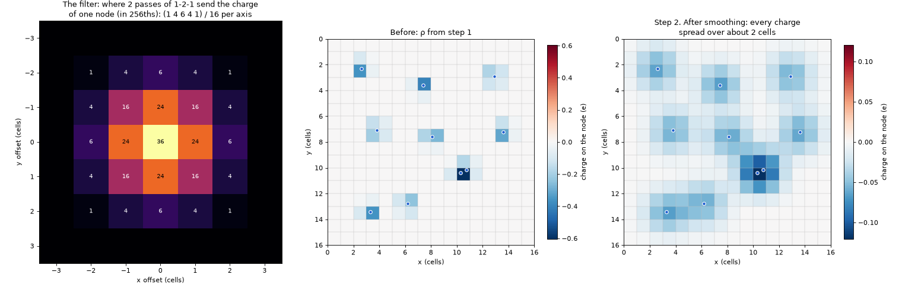
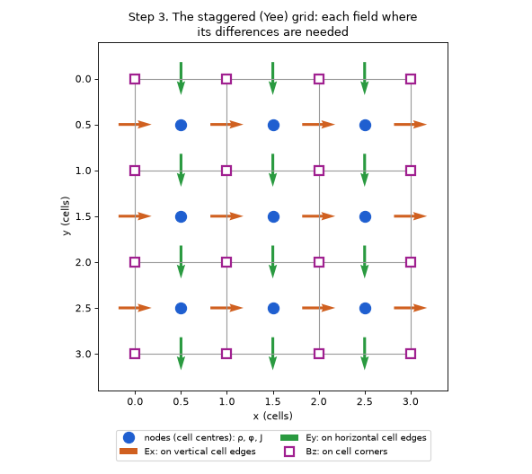
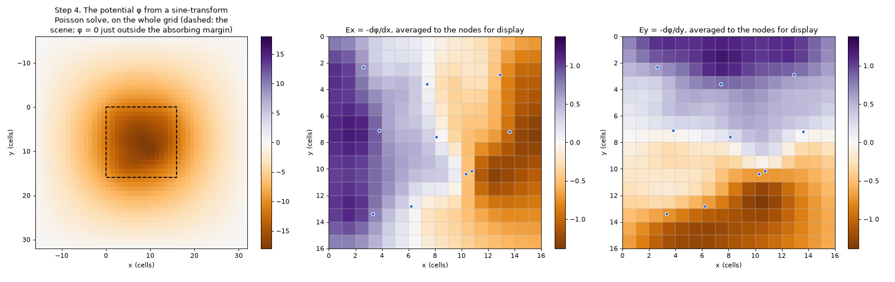
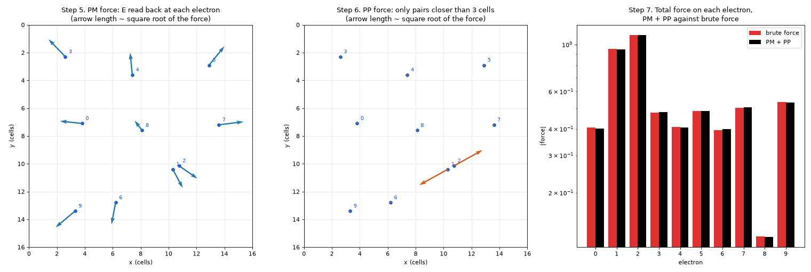

# How the fields are computed

Every tick, each electron needs the electric and magnetic force of every other charge on the
canvas, and those forces must include induction and waves. A large scene has tens of thousands of
electrons, so Embloks steps **Maxwell's equations on the grid**, the *particle-in-cell* method of
plasma physics, and adds the forces between close electrons pair by pair. Together that is the
idea behind P3M (*particle-particle particle-mesh*), with a time-stepped field solver as the mesh
part.

You don't need any of this to use the app. This page is for readers who know Maxwell's
equations, the basics of particle simulations and what a Fourier (sine) transform does, but have
never seen a particle-in-cell code. It explains the method with a small example scene, step by
step, and then the details that make it work in Embloks.

- [The problem: brute force is too slow, and too instant](#the-problem-brute-force-is-too-slow-and-too-instant)
- [Electromagnetism in 2D](#electromagnetism-in-2d)
- [The idea: a grid for the far part, pairs for the near part](#the-idea-a-grid-for-the-far-part-pairs-for-the-near-part)
- [The example scene](#the-example-scene)
- [PM: the far part, on the grid](#pm-the-far-part-on-the-grid) (steps 1-5)
- [PP: the near part, pair by pair](#pp-the-near-part-pair-by-pair) (step 6)
- [Adding up](#adding-up) (step 7)
- [Waves and the border](#waves-and-the-border)
- [Ions, test charges and batteries](#ions-test-charges-and-batteries)
- [Other techniques](#other-techniques)

## The problem: brute force is too slow, and too instant

The direct way: for each electron, loop over all other charges and add up Coulomb's law. That
costs N² pair evaluations per step: at 76,000 electrons (a 200 × 160 grid, 30% wire) 6·10⁹ pairs,
many times per second. Far too slow.

It is also incomplete. Coulomb's law (and Biot-Savart's for the magnetic field) say how the
fields of charges and steady currents look *right now*. They know nothing of a changing magnetic
field driving an electric one (induction), or of fields spreading at the speed of light (waves).
For that you need Maxwell's equations themselves.

Maxwell's equations are *local*: how a field changes at a point depends only on the fields and
currents right there. Stepped on a grid, each cell only talks to its neighbours, so a step costs
about one operation per cell however many electrons there are, and induction and waves come out
by themselves.

## Electromagnetism in 2D

Embloks is two-dimensional: everything is uniform out of the screen. A "charge" is therefore an
infinitely long line of charge, and electrons move only in the plane. E lies in the plane and B
points straight out of it (a single number per point, Bz). Maxwell's equations become:

    dBz/dt = -(dEy/dx - dEx/dy)                  Faraday's law
    dE/dt  = c² (dBz/dy, -dBz/dx) - 4πk J        Ampère's law
    div E  = 4πk ρ                               Gauss's law

with k = 1 (`coulomb_k`) and c = 8 cells per time unit (`speed_of_light`). Gauss's law gives a
line charge the field 2kq/r: it falls off as 1/r, not 1/r². A current loop in the plane is really
an infinitely long solenoid: B is uniform inside and zero outside, and its inductance is
μ0 × area = 4πk/c² × area. That is why c is 8 rather than lower: at c = 2 circuits are 16 times
more inductive, and a capacitor charged through its wires rings around the battery voltage for
hundreds of time units.

## The idea: a grid for the far part, pairs for the near part

A grid can only describe fields that vary smoothly from cell to cell. So the charges are
*smoothed* before they go on the grid: every charge becomes a cloud about two cells wide. That is
fine at a distance, but electrons a fraction of a cell apart then barely feel each other, and
crowd together. So the force between every pair is split in two:

- **The far part (PM, particle-mesh):** the force between two smoothed clouds, which is what the
  grid delivers. Smooth, long-ranged, and computed for all charges at once: put the charges on
  the grid, step the fields, read them back at the electrons. It costs about one operation per
  cell plus a few per electron.
- **The near part (PP, particle-particle):** the *difference* between the force we want between
  compact electrons and what the grid delivers. It is large at short distance, and negligible
  beyond a few cells, because there the grid's clouds look like points. It is computed pair by
  pair, only for electrons closer than the cutoff (3 cells, `electron_cutoff`).

Fields (and forces) are linear in the charges, so the field of all charges is the sum of the
parts, however each was computed.

The far part (blue) is the grid's force between two charges, *measured* with the grid code
itself and averaged over where the charges sit in their cells. The wanted force (dotted) is that
of two line charges each smeared as a Gaussian of width 0.25 cell (`electron_softening`):
2kq²·r/r² · (1 - exp(-r²/0.25²)). The near part (orange) is the difference. At the cutoff it
has fallen to 0.3% of its peak, so it is simply dropped beyond. The sum (dashed) follows the
wanted force at every distance.

| Method      | Short range | Long range | Induction, waves | Cost per step   |
|-------------|-------------|------------|------------------|-----------------|
| Brute force | exact       | exact      | no               | N²              |
| PM only     | too weak    | good       | yes              | N + M           |
| PM + PP     | exact (PP)  | good (PM)  | yes              | about N + M     |

(N electrons, M cells. The Poisson solve of step 4 adds M·log M.)

## The example scene

Ten electrons of charge -0.5 e on a 16 × 16 cell canvas, in vacuum, the fields at rest.
Electrons 1 and 2 are only 0.52 cell apart, so that the PP step has a pair to work on. Lengths
are in cells. The y axis points down, as on screen.

## PM: the far part, on the grid

### Step 1. Put the charges on the grid (cloud-in-cell)

The grid nodes are the cell centres. Electrons sit anywhere, so each electron's charge is shared
over the 4 nodes around it, with bilinear weights: the closer the node, the larger its share.

Electron 0 sits at (3.8, 7.1). The nodes around it are at x = 3.5 and 4.5 (node columns 3 and 4)
and y = 6.5 and 7.5 (node rows 6 and 7). It is 0.3 of the way from column 3 to column 4, and 0.6
of the way from row 6 to row 7, so its weights are:

| Node (column, row) | Weight           |
|--------------------|------------------|
| (3, 6)             | 0.7 · 0.4 = 0.28 |
| (4, 6)             | 0.3 · 0.4 = 0.12 |
| (3, 7)             | 0.7 · 0.6 = 0.42 |
| (4, 7)             | 0.3 · 0.6 = 0.18 |

The weights add up to 1, so no charge is lost. Doing this for all electrons gives the charge grid
ρ: one number per node, -5 e in total. Moving electrons carry current, q·v, which is deposited the
same way into the current grid J. In the code this is `CloudInCell.deposit` in
[fields.py](../src/embloks/fields.py).

### Step 2. Smooth

A charge on a single node would give a field that changes wildly within a cell: an electron in a
one-cell-wide wire would be pushed around depending on where exactly it sits. So ρ and J go
through a 1-2-1 filter along x and along y, twice (`smoothing_passes`): each node keeps half its
charge and gives a quarter to each neighbour, per axis and pass. After two passes a node's charge
is spread as (1 4 6 4 1)/16 per axis, over about two cells.

Smoothing is the grid's counterpart of giving every charge a size. Fewer passes make the grid
force on an electron depend more on where it sits within its cell, which heats the electrons (it
jitters as they move); more passes widen every charge, and with it the reach of the near part.

### Step 3. Step Faraday's and Ampère's laws on the staggered grid

The fields live on a *staggered* (Yee) grid: Ex on the vertical cell edges, Ey on the horizontal
ones, Bz on the corners. Each field then sits exactly between the values it is computed from:
Faraday's law changes Bz at a corner by the curl of the E values on the four edges around it,
and Ampère's law changes Ex on an edge by the difference of Bz at its two ends (and the current
there, averaged from the two nodes it joins).

The two updates leapfrog: half a step of B, a full step of E, another half step of B (in
`Maxwell.step`, [maxwell.py](../src/embloks/maxwell.py)). This is second-order accurate and
conserves the field energy, as long as light crosses less than 1/√2 cell per step (the CFL
condition). At c = 8 and a tick of 1/30 that is 0.38 cell; a faster c is split into substeps.

### Step 4. Enforce Gauss's law

Steps 1-3 never look at ρ, only at J. In theory that is enough (the charge only changes by
currents carrying it), but in Embloks charge also jumps without a current: you paint a wire, or
a battery takes an electron from one terminal and puts it at the other. And the field has to
start from somewhere. So after every tick E is corrected to satisfy Gauss's law exactly:

    φ = solution of ∇²φ = div E - 4πk ρ;    E ← E - ∇φ

The correction is a gradient, which has no curl: it changes neither B nor the waves, only the
part of E set by the charges. That part is thereby always the instantaneous Coulomb field of the
present charges (the Coulomb gauge), and only the fields of changing currents travel at c.

Poisson's equation is solved exactly in one go: with zero potential just outside the grid, the
discrete Laplacian is diagonal in the type-I sine transform, so it is a forward transform, a
division and an inverse transform (`Maxwell._poisson`). The same solve also gives the electric
potential of the charges, which the batteries measure.

The field points towards the electrons (they are negative), and is smooth: around the close pair
1 and 2 it looks like the field of a single charge.

### Step 5. Read E and B back at the electrons

Each electron reads Ex, Ey and Bz by bilinear interpolation, *each from its own staggered grid*,
and feels the Lorentz force F = q(E + v × B) (`Maxwell.gather`).

Why not average the fields to the nodes first, and read them with the cloud-in-cell weights of
step 1? Because averaging two neighbouring edges cancels a field that alternates from cell to
cell. A "checkerboard" of charge, alternating + and - from cell to cell, has exactly such a
field: electrons reading node averages would feel nothing from it, nothing would push it back,
and it would grow without limit.

The left panel shows the PM forces. Electrons 1 and 2, half a cell apart, hardly push each other:
their PM forces mostly come from the other electrons.

## PP: the near part, pair by pair

### Step 6. Add the near force for close pairs

Every pair closer than the cutoff gets the near force of the split above, equal and opposite. In
the example only electrons 1 and 2 are close enough to matter (middle panel); they now repel
strongly. In the code this is `CloseRange.force` in
[close_range.py](../src/embloks/close_range.py).

The near force is tabulated once against r², so a pair costs a table lookup, not an exponential.
To find the pairs, the electrons are sorted by cell, and each one only checks the cells within
the cutoff. In a conductor with 8 electrons per cell that still leaves 100-200 neighbours per
electron, so this loop is compiled with Numba rather than written as NumPy array operations
(which would need large temporary arrays of all pairs). It is the most expensive part of a
tick on large canvases.

## Adding up

### Step 7. Total force, then move

The total force on each electron is PM + PP. Then the electrons move: their velocity changes by
F/m·dt, minus the drag of the cell they are in, and they take their step (`physics.step` in
[physics.py](../src/embloks/physics.py)). Finally the fields advance by one tick with the new
charge and current, steps 1-4. Next tick, the forces are read from those fields.

The right panel of the force figure compares PM + PP with brute force: direct sums of the wanted
force over all pairs. Every electron is within 0.6-3.3%, the close pair included. The small
differences come from the grid's border (the potential is zero just outside the absorbing margin,
not at infinity) and from the far part's slight dependence on where in their cells the electrons
sit, which the near part only corrects on average.

## Waves and the border

Waves have to leave the canvas without bouncing back off its edge. So the grid extends 16 cells
beyond the canvas on every side (`absorbing_margin`), and in that margin E and B are damped,
gently at first and more strongly towards the outside (`absorbing_strength`). A wave entering it
fades before it can come back.

Charges and currents never enter the margin, so the smoothing of step 2 only has to look at the
canvas plus a border as wide as it spreads.

## Ions, test charges and batteries

### Ions

Every conductor cell holds a fixed positive ion of +4 e spread evenly over the cell. Ions are
handled with the same two parts:

- **PM:** the cloud-in-cell shares of a charge spread evenly over a cell are 1/8, 3/4, 1/8 per
  axis (1), smoothed like everything else (2). Neighbouring ions then form an even positive
  background with no favoured spot inside a cell.
- **PP:** within the cutoff, an ion is the evenly spread charge itself (3), minus its grid part:
  the near correction of a point charge, integrated over the cell. That is tabulated once; an
  electron adds the table's value for every conducting cell within reach.

Electrons and ions go through the same deposit and smoothing, so a neutral cell makes no field.
An electron gas evenly filling a conductor feels no net near force either.

### What the electrons look like

On the grid, an electron's shape depends a little on where it sits in its cell (top row). In the
near part it is a compact ball of width 0.25 (bottom row).

Without the PP step (set `electron_cutoff` to 0), electrons in a thin wire collapse into a few
tight stacks: two electrons at the same spot feel no force from each other through the grid, and
identical forces keep them together. With it, they spread evenly over the wire (the right
picture starts from the same stacked state):

### Test charges

Test charges sit on cell centres and go on the grid like everything else. They have no near
part.

### Batteries

A battery measures the potential difference between its terminals and moves electrons from one
to the other at the rate (EMF - V) / R. It reads the potential of step 4 plus the near part's,
averaged over each cell (at a single point it would jump with every electron passing by):
electrons crowded at a terminal push harder than the grid potential alone shows.

In 2D one electron moved across a battery shifts its terminal voltage by about 2. Moving charge
at (EMF - V) / R and only then looking at V again would overshoot whenever that shift exceeds
2R/dt per unit charge, and swing harder every tick (for a single battery cell, R = 0.1, it is
just over). So the step is implicit: the rate is (EMF - V) / (R + G·dt), where G is how much the
battery's own transfers move its voltage. G is computed once per painted circuit, by solving for
the potential of a unit charge moved across each battery (summed over batteries that share
terminals, which push each other's voltages too). The steady state is unchanged: V = EMF - I·R.

## Other techniques

- **Stable drag.** Resistance is applied implicitly, `v ← (v + a·dt) / (1 + Γ·dt)`, which stays
  stable for any resistance; a simple explicit update would blow up at high resistance.
- **Substeps.** If electrons move fast, a tick is split into smaller steps so that nothing moves
  more than 0.4 cell at a time and can't tunnel through a one-cell wall.
- **Large time step.** Drag is stable at any step and the electron motion is smooth, so a tick
  can cover 1/30 time unit.
- **Gauss's law once per tick.** When light needs substeps, only the leapfrog is repeated: the
  correction of step 4 has no curl, so it can wait until the end of the tick.
- **Smoothing near the canvas only.** The charge grid is smoothed on the canvas plus a two-cell
  border, then placed in the larger grid with its margin: the same result for less work.
- **Painting while paused.** Charge painted between ticks gets its field at once: step 4 is run
  again whenever the materials or test charges change, so the display never shows stale fields.
- **Drawing.** Arrow geometry is computed for all arrows at once with NumPy, then drawn with one
  call per arrow; layers at full opacity draw straight to the screen, and only translucent ones
  go through an overlay. Electrons are one pre-drawn dot sprite blitted in a single batched
  call, or single pixels written into the screen array when there are very many. On fine grids
  only every n-th cell gets a field arrow. The material image is only redrawn after painting.

## Regenerating the figures

All figures on this page are drawn by [make_figures.py](make_figures.py) with the app's own code.
It needs matplotlib: `pip install matplotlib`, then `python docs/make_figures.py` from the
repository root.
