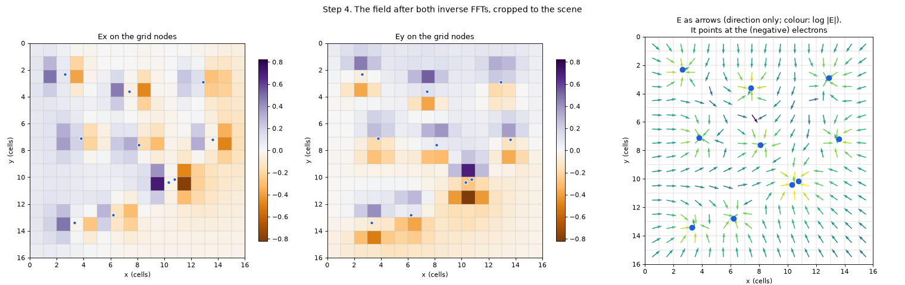
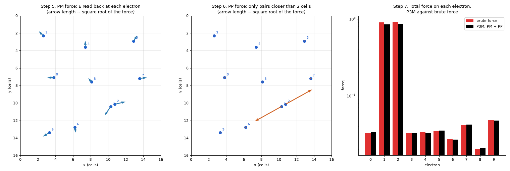

# How the forces are computed (P3M)

Every tick, each electron needs the electric force of every other charge on the canvas. A large
scene has tens of thousands of electrons, so Embloks computes these forces with **P3M**
(*particle-particle particle-mesh*), the standard method for long-range forces in particle
simulations (plasmas, molecular dynamics, galaxies).

You don't need any of this to use the app. This page is for readers who know the FFT and the
convolution theorem, Coulomb's law and the basics of particle simulations, but have never seen
P3M. It explains the method with a small example scene, step by step, and then where Embloks
departs from the textbook version.

- [The problem: brute force is too slow](#the-problem-brute-force-is-too-slow)
- [The idea: split every force in two](#the-idea-split-every-force-in-two)
- [The example scene](#the-example-scene)
- [PM: the far part, on a grid](#pm-the-far-part-on-a-grid) (steps 1-5)
- [PP: the near part, pair by pair](#pp-the-near-part-pair-by-pair) (step 6)
- [Adding up](#adding-up) (step 7)
- [Ions, test charges and the magnetic field](#ions-test-charges-and-the-magnetic-field)
- [Embloks versus textbook P3M](#embloks-versus-textbook-p3m)
- [Other techniques](#other-techniques)

## The problem: brute force is too slow

The direct way: for each electron, loop over all other charges and add up Coulomb's law. Embloks
uses a *softened* Coulomb law, which treats each charge as a small Gaussian cloud of size ε
(density ∝ exp(-r²/ε²)) instead of a point. Its potential is

    V = k·q · erf(r/ε) / r

Far away (r ≫ ε) this is plain Coulomb: erf(r/ε) is within 0.05% of 1 beyond 2.5 ε. Up close it
stays finite instead of blowing up, and the force is zero at r = 0, so a charge never pushes
itself.

This loop costs N² pair evaluations per step. At 76,000 electrons (a 200 × 160 grid, 30% wire)
that is 6·10⁹ pairs, many times per second. Far too slow.

## The idea: split every force in two

P3M writes the force between every pair as the sum of two parts and computes each part with the
method that suits it:

- **The far part (PM, particle-mesh)**: smooth, with no spike at short distance, but long-ranged.
  Because it is smooth, it can be computed on a coarse grid (the *mesh*): put the charges on the
  grid, solve for the field there with FFTs, and read it back at the electrons. This costs about
  M·log M for M grid cells, *however many* electrons there are.
- **The near part (PP, particle-particle)**: what is left: large at short distance, zero beyond a
  small cutoff distance r_c. It is computed exactly as in brute force, pair by pair, but only for
  pairs closer than r_c. Each electron has only a handful of such neighbours, so this costs about N.

Why is this allowed? **Superposition**: fields (and forces) are linear in the charges, so the field
of all charges is the sum of the fields of the parts, however they were computed. That is also what
makes the grid step possible: it handles the far part of *all* pairs at once by computing the field
of the whole (smeared) charge distribution in one go.

Embloks uses the textbook split from Ewald summation, `1/r = erf(αr)/r + erfc(αr)/r`, which is
exact for any α since erf + erfc = 1:

- **Far part:** `erf(αr)/r` with α = 1/0.8 cell: Coulomb softened by ε = 0.8 cell
  (`conductor_softening`). Every charge is a Gaussian cloud about a cell wide: smooth enough for a
  grid whose spacing is one cell.
- **Near part:** the rest, `erfc(αr)/r`. It falls off like a Gaussian, so it is simply dropped
  beyond the cutoff r_c = 2 cells (`electron_cutoff`), where it is 0.6% of the force (α·r_c = 2.5,
  a usual textbook choice).

One change to the textbook: Embloks' electrons are not points but compact clouds of size 0.25
(`electron_softening`), so that two electrons on the same spot don't feel an infinite force. Their
interaction is `erf(r/0.25)/r`, and the near part is what that adds to the far part:
`erfc(r/0.8)/r - erfc(r/0.25)/r`. For point electrons (size 0) the second term vanishes and this is
the textbook erfc.

Inside the cutoff, far + near is exactly the compact force. Beyond it, charges interact as the
ε = 0.8 clouds, which are within 0.6% of the compact force there and indistinguishable from it
past 2.5 cells.

| Method      | Short range       | Long range | Cost per step          |
|-------------|-------------------|------------|------------------------|
| Brute force | exact             | exact      | N²                     |
| PM only     | smeared (too weak) | good       | N + M·log M            |
| P3M (PM+PP) | exact (PP)        | good (PM)  | about N + M·log M      |

## The example scene

Ten electrons of charge -0.5 e on a 16 × 16 cell canvas, in vacuum. Electrons 1 and 2 are only
0.52 cell apart, so that the PP step has a pair to work on. Lengths are in cells and the Coulomb
constant k = 1. The y axis points down, as on screen.

## PM: the far part, on a grid

### Step 1. Put the charges on the grid (cloud-in-cell)

The grid nodes are the cell centres. Electrons sit anywhere, so each electron's charge is shared
over the 4 nodes around it, with bilinear weights: the closer the node, the larger its share.

Electron 0 sits at (3.8, 7.1). The nodes around it are at x = 3.5 and 4.5 (node columns 3 and 4)
and y = 6.5 and 7.5 (node rows 6 and 7). It is 0.3 of the way from column 3 to column 4, and 0.6
of the way from row 6 to row 7, so its weights are:

| Node (column, row) | Weight          |
|--------------------|-----------------|
| (3, 6)             | 0.7 · 0.4 = 0.28 |
| (4, 6)             | 0.3 · 0.4 = 0.12 |
| (3, 7)             | 0.7 · 0.6 = 0.42 |
| (4, 7)             | 0.3 · 0.6 = 0.18 |

The weights add up to 1, so no charge is lost. Doing this for all electrons gives the charge grid
ρ: one number per node, -5 e in total. In the code this is `CloudInCell.deposit` in
[fields.py](../src/embloks/fields.py).

Electrons 1 and 2 have merged into one blob around node (10, 10): on the grid, they are almost the
same charge in the same place. The PM step can't push them apart; that is what the PP step is for.

### Step 2. Zero-pad and FFT the charge grid

The field at node i is a sum over all nodes j:

    E[i] = Σⱼ K(i - j) · ρ[j]

where K(d) is the field at offset d from one unit charge: the *kernel* (or Green's function). This
is a **convolution**. Done directly it costs M² operations, but by the convolution theorem it is a
multiplication in frequency space: FFT ρ, multiply by the FFT of K, inverse FFT.

One catch: an FFT convolution is *circular*. It treats the grid as periodic, so charges near the
right edge would also act on nodes at the left edge. Textbook P3M simulates a periodic box, so
there that is exactly what it wants. Embloks' canvas is not periodic, so the charge grid is
zero-padded to at least 2n - 1 nodes per axis (here 31, rounded up to 32, a fast FFT length). The
wrapped-around contributions then land only in the padding, which is thrown away in step 4.

Panel **a** is the input, panel **b** the magnitude of its 2D FFT ρ̂ (zero frequency in the
middle). The centre value is the sum of all charge (magnitude 5). The rest is a broad, noisy
spectrum: the charges are small blobs at irregular places, so they contain every spatial
frequency.

### Step 3. Multiply by the kernel's spectrum (the filter)

For a periodic box, textbook P3M writes the filter down directly in frequency space: the Fourier
transform of the far part's Green's function (for 3D charges in 3D, 4π/k² times the Gaussian
low-pass exp(-k²/4α²) of the erf split), with the field following as Ê = -ik·φ̂. The canvas here
is not periodic, so Embloks uses the textbook method for *isolated* systems instead (Hockney &
Eastwood, *Computer Simulation Using Particles*): sample the Green's function in real space on the
doubled grid of step 2, and FFT it. Kx is the x component of the field of one unit charge with
softening 0.8 (the erf far part), at every node offset from -(n - 1) to n - 1:

    Kx(dx, dy) = k·dx · (erf(r/ε) - 2r/(√π·ε)·exp(-r²/ε²)) / r³ + ΔKx      (Ky likewise with dy)

with r² = dx² + dy² (the first term is 0 at r = 0). Sampling in real space also gets the geometry
right: charges here are 3D point charges confined to a plane, with a 1/r potential, whose 2D
transform is 2π/|k| (times erfc(k/2α) for the far part), not the 1/k² of charges in 3D.

ΔKx is the textbook **assignment correction**. Cloud-in-cell smears every charge twice, once when
it is put on the grid (step 1) and once when the field is read back (step 5), which weakens the
grid force between charges a cell or two apart. Hockney & Eastwood's *optimal influence function*
compensates for this, including the aliasing of frequencies above the grid's resolution, so that
the grid force is as close as possible to the erf force, averaged over where the charges sit in
their cells. In frequency space it is

    K̂_opt(k) = Σₘ Û(kₘ)² R̂(kₘ) / (Σₘ Û(kₘ)²)²,      kₘ = k + 2π·m

with Û the cloud-in-cell window (sinc² per axis), R̂ the transform of the erf field and m running
over the aliases. ΔKx is the difference between K̂_opt and the spectrum of the sampled erf field,
transformed back to real space: a short correction that mostly boosts the nearest nodes (middle
panel below). It still leaves Kx antisymmetric, so step 5's guarantees hold. The potential kernel
gets the same correction. Kx is computed once per grid size and cached, with its FFT K̂x.

The spectrum shows what the filter does:

- **Zero on the column kx = 0.** Kx is odd in x, like a derivative (-ikx in frequency space): a
  pattern that doesn't vary along x has no field along x. This also drops the k = 0 term, the
  total charge, which on its own would give a uniform field.
- **Strong at low |k|, weak at high |k|.** The 1/|k| of a point charge's potential in a plane
  amplifies large-scale patterns: that is the long range of Coulomb's law. The Gaussian low-pass
  of the erf split damps the fine detail.

Panel **c** of the step 2 figure is the product ρ̂·K̂x: the noisy spectrum with its high
frequencies and its kx = 0 column suppressed. The same is done with K̂y for Ey.

### Step 4. Inverse FFT: the field on the grid

An inverse FFT of ρ̂·K̂x gives panel **d**: Ex on the padded 32 × 32 grid. Because the kernel's
zero offset sits at index n - 1, the scene's nodes are the dashed block starting at index 15. That
block is kept; the rest is the padding. Another inverse FFT, of ρ̂·K̂y, gives Ey.

The field points towards the electrons (they are negative), and is smooth: around the merged
pair 1 and 2 it looks like the field of a single charge. One step costs one forward FFT and two
inverse FFTs (plus one more for the potential, which the batteries need, with the kernel
k·erf(r/ε)/r plus its correction). In the code this is `GridKernel` in [fields.py](../src/embloks/fields.py).

### Step 5. Read the field back at the electrons

Each electron reads E from the same 4 nodes, **with the same weights** as in step 1:
E = Σ weight · E[node], and its force is F = q·E (`CloudInCell.gather`).

Using the same weights both ways matters: since the kernel is antisymmetric, an electron then
feels exactly zero force from its own charge, and the grid force between any two electrons is
equal and opposite (momentum is conserved).

The left panel shows the PM forces. Electrons 1 and 2, half a cell apart, hardly push each other:
their PM forces mostly come from the other electrons.

## PP: the near part, pair by pair

### Step 6. Add the near force for close pairs

Pairs closer than the cutoff are found with a k-d tree (no need to check all N² pairs), and the
near force of the split above is added to each, equal and opposite. In the example only electrons
1 and 2 are that close (middle panel); they now repel strongly. In the code this is
`CloseRange.force` in [fields.py](../src/embloks/fields.py). Evaluating erf and exp for every pair
is slow, so, as is usual in P3M codes, the near force is read from a table over r² instead
(accurate to about 10⁻⁵ of its peak).

In a conductor with 8 electrons per cell, each electron has about 100 neighbours within 2 cells,
so the PP step takes most of the time of a physics step. Large solid conductors cost more,
because the number of close pairs grows with them.

## Adding up

### Step 7. Total force, then move

The total force on each electron is PM + PP (plus the magnetic force, see below). Then the
electrons move: their velocity changes by F/m·dt, minus the drag of the cell they are in, and they
take their step (`physics.step` in [physics.py](../src/embloks/physics.py)). Next tick, everything
starts again from step 1.

The right panel of the force figure compares P3M with brute force (direct Coulomb sums with the
compact softening of 0.25). Electrons far from others are within 0.5-5%. The close pair comes out
6% low. The split itself is exact at their distance, but the PP step assumes the grid delivers
the smooth ε = 0.8 force between them. The assignment correction gets the grid close to that on
average over positions, not for every pair: here both electrons share the same few nodes. Without
the correction the pair came out 10% low; on random clouds of electrons the correction halves the
rms force error (to 3.5-6%, depending on density).

## Ions, test charges and the magnetic field

### Ions

Every conductor cell holds a fixed positive ion of +4 e spread evenly over the cell. Ions are
handled with the same two parts:

- **PM:** the cloud-in-cell shares of a charge spread evenly over a cell are 1/8, 3/4, 1/8 per axis
  (1). Each share is smeared with ε = 0.8, like the electrons (2). Neighbouring ions then form an
  even positive background with no favoured spot inside a cell. Ions only change when you paint, so
  their field is computed once and cached.
- **PP:** within the cutoff, an ion is the evenly spread charge itself (3), minus its grid part.
  This only depends on which cells around an electron conduct, so it is tabulated once per
  distinct 5 × 5 neighbourhood when you paint, and read back with one lookup per electron.

Electrons and ions must be smeared alike on the grid: only then does a neutral cell produce no
field. An electron gas evenly filling a conductor then feels no net near force either.

### What the electrons look like

On the grid, an electron's shape depends on where it sits in its cell: on a cell centre it looks
exactly like an ion, on a corner it is a broad, flat cloud (top row). Two electrons a quarter of a
cell apart therefore barely repel through the grid. In the near part they are compact balls of
softening 0.25 (bottom row).

Without the PP step (set `electron_cutoff` to 0), electrons in a thin wire collapse into a few
tight stacks: two electrons at the same spot feel no force from each other through the grid, and
identical forces keep them together. With it, they spread evenly over the wire (the right picture
starts from the same stacked state):

The batteries include the near part when they read their terminal voltage (averaged over each
cell, as at a single point it would jump with every electron passing by): electrons crowded at a
terminal push harder than the grid potential alone shows.

### Test charges

Test charges sit on cell centres and use their own kernel, with softening 0.5
(`test_charge_softening`). Sitting exactly on nodes, they aren't smeared when put on the grid, so
their kernel has no assignment correction and their field on the nodes is exact. Like the ions,
their field is cached until you paint.

### Magnetic field

The magnetic field reuses the same kernels. The electrons' current (charge × velocity) is put on
the grid with the same cloud-in-cell weights, and B = (Jx·Ky - Jy·Kx) / c² (the Biot-Savart law)
is computed in frequency space: two forward FFTs, the two products combined, and one inverse FFT.

## Embloks versus textbook P3M

| | Textbook P3M | Embloks |
|---|---|---|
| Boundaries | periodic box | isolated canvas: zero-padding to 2n - 1 (Hockney's method) |
| Split | erf / erfc, exact | erf / erfc, exact; electrons are compact clouds (size 0.25), not points |
| Filter | influence function written in k-space: 4π/k², Gaussian | FFT of the real-space erf kernel sampled on the doubled grid, computed once |
| Assignment correction | optimal influence function | the same, added to the sampled kernel; not for test charges, which sit on nodes |
| Geometry | 3D charges in 3D (or 2D in 2D) | 3D point charges in a plane: 2π/\|k\| potential, 1/r² forces |
| Fixed charges | - | ions and test charges cached until painted |

## Other techniques

- **Shared weights.** The cloud-in-cell weights are computed once per substep and reused for
  depositing charge and current and for reading E and B back at every electron.
- **Fewer FFTs.** Real-input FFTs (`rfft2`) store only half the spectrum. B's two convolution
  terms are combined in frequency space before transforming back, saving an inverse FFT. (Fusing
  E and B into one batched FFT was tried and measured slower, so it isn't done.)
- **Stable drag.** Resistance is applied implicitly, `v ← (v + a·dt) / (1 + Γ·dt)`, which stays
  stable for any resistance; a simple explicit update would blow up at high resistance.
- **Substeps.** If electrons move fast, a tick is split into smaller steps so that nothing moves
  more than 0.4 cell at a time and can't tunnel through a one-cell wall.
- **Large time step.** Drag is stable at any step and the electron motion is smooth, so a tick
  can cover 1/30 time unit; results were checked to be identical up to 1/8.
- **Dynamic fields (FDTD).** In dynamic mode (`M`), P3M is replaced by Maxwell's equations stepped
  in time. E and B live on a staggered (Yee) grid: Ex and Ey on cell edges, B on cell corners,
  stepped with Faraday's and Ampère's laws in a leapfrog. After every step E is corrected so that
  Gauss's law holds exactly (divergence cleaning, solved with a sine transform); the electrostatic
  part is thereby instantaneous, as in the Coulomb gauge, and only fields of changing currents
  travel at c. That also keeps the fields right when charge jumps without a current (painting,
  battery transfers). A 16-cell margin with gradually rising damping absorbs outgoing waves.
  Electrons read each field component from its own staggered position: averaging onto cell
  centres first would hide an odd/even checkerboard of charge from them, which then grows
  unchecked. Charge and current pass through a 1-2-1 smoothing filter (twice), dynamic mode's
  counterpart of the softening length. If light would cross more than ~0.6 cell per tick, the
  field step is split into substeps (the CFL stability limit).
- **Drawing.** Arrow geometry is computed for all arrows at once with NumPy, then drawn with one
  call per arrow; layers at full opacity draw straight to the screen, and only translucent ones
  go through an overlay. Electrons are one pre-drawn dot sprite blitted in a single batched
  call, or single pixels written into the screen array when there are very many. On fine grids
  only every n-th cell gets a field arrow. The material image is only redrawn after painting.

## Regenerating the figures

All figures on this page are drawn by [make_figures.py](make_figures.py) with the app's own code
(the walkthrough checks that its step-by-step FFTs match `GridKernel` exactly). It needs
matplotlib: `pip install matplotlib`, then `python docs/make_figures.py` from the repository root.
